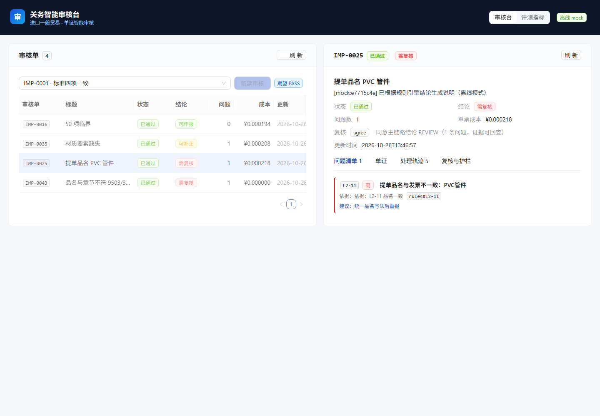
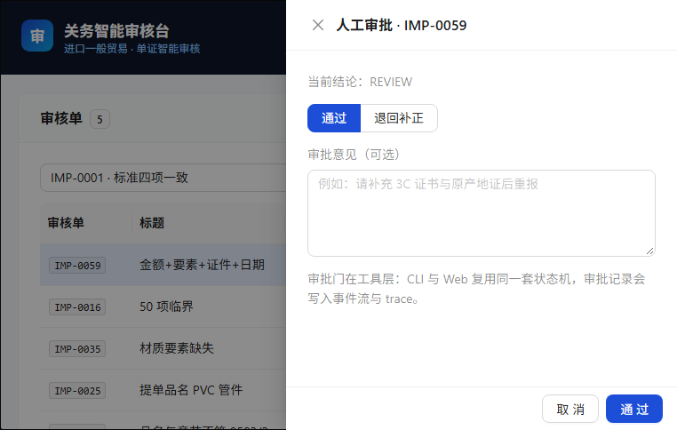

# 关务智能审核 Agent

进口一般贸易报关单证的智能审核：四单一致性、申报要素、归类建议、监管证件，输出「可申报 / 可补正 / 需复核 / 不可申报」。

> 状态：**W6.5 完成** —— 46 条规则 + RAG（检索评测 recall@3 100%）+ 引用链 + 多 Agent 复核 + MCP + 红队 + Judge + 成本/限流/幂等 + FastAPI/AntD 审核台 + **单证导入 / 追问 / 文本抽取 / Agent Skill / 向量表 / 异步 API / Docker / CI / 11 项指标门禁**；269 条测试全绿。
> 交接入口：[`AGENTS.md`](AGENTS.md) → [`docs/00-project-context.md`](docs/00-project-context.md)

## 为什么做这个

对接「AI 单证识别」之后的决策环节：识别只解决“单子读没读出来”，本项目解决“这张单能不能报、缺什么、该找谁补”。

## 设计要点

- **四层校验**：完整性 / 单证一致 / 申报要素与归类 / 监管合规
- **四分类结论**：PASS / FIX / REVIEW / REJECT
- **只给建议不给判决**：归类只到 6 位，强制人工确认
- **确定性优先**：字段比对走规则，不让 LLM 猜
- **离线可跑**：mock 模型可复现全部评测
- **审批门在工具层**：CLI 与 Web 复用同一套状态机与事件流

## Web 审核台



- 左侧审核单列表（筛选 / 新建审核 / 状态与结论标签 / 单票成本）；
- 「导入单证」支持粘贴或上传 JSON，可载入示例；导入后自动编号并进入详情；
- 右侧单票详情：问题清单、五份单证、处理轨迹、复核与护栏；
- `PENDING_APPROVAL` 时打开审批 Drawer，通过 / 退回都会写事件流与 trace；
- 评测指标页展示准确率、召回、误报、引用覆盖、P95、单票成本与逐条结果。

单证示例：[`examples/docs.example.json`](examples/docs.example.json)（合成数据）。顶层是
`contract / invoice / packing_list / bl / declaration` 五份单证，至少给 `invoice` 或 `declaration`。

更多真实感测试数据（5 票，覆盖 PASS / FIX / REVIEW / REJECT）：
[`examples/realistic/`](examples/realistic/)——字段参照海关总署填制规范与 UPS 商业发票指南。



### 三种启动方式

```bash
# 1) 无第三方依赖兜底：stdlib HTTP + 原生 HTML（客户现场没 Node 也能演示）
make demo                 # http://127.0.0.1:8000
#    有 web/dist 时自动服务 AntD 构建；没有就用 web/fallback/index.html

# 2) FastAPI（需要 fastapi/uvicorn）
make api                  # http://127.0.0.1:8000

# 3) 前端开发：Vite 5173，/api 代理到 8000
make web-install
make web-dev
make web-build            # 类型检查 + 构建到 web/dist
```

## Docker

```bash
make docker-build         # docker build -t logistics-agent:latest .
make docker-run           # 起容器，映射 8000，挂载 ./var
make docker-up            # docker compose up --build
```

镜像多阶段构建：Node 负责 AntD 构建，Python 3.12-slim 只带运行时；非 root 用户、
`/api/health` healthcheck、`./var` 持久化审核单与 trace。详见 `docs/03-architecture.md` 第 15 节。

## CI 与指标门禁

`.github/workflows/ci.yml` 三条 job：

| job | 内容 |
|---|---|
| Python | `make test` → `make eval` → `make gate`，上传评测报告 |
| Web | OpenAPI → `pnpm gen:types` → `pnpm build` |
| Docker | 构建镜像（不推送） |

`make gate` 卡 9 项：准确率、召回、误报、引用覆盖、单票成本、并发 10 P95、
性能错误数、红队拦截数、`auto_change_hs`。任何一项不达标直接失败。

## 数据与合规

- 全部单证数据为**合成数据**，不含任何真实企业名、单号或个人信息。
- 规则依据来自公开的报关单填制规范、税则、监管条件表；企业内审阈值属**假设**，在评测报告中标注。

## 目录

```
docs/   00 上下文 · 01 规则库 · 02 评测规范 · 03 架构 · 04 使用手册 · 05 演示脚本 · 06 面试问答
src/    harness · rules · rag · domain · tools · agents · mcp · app · application · adapters
web/    AntD 5 + React 18 + TS + Vite + TanStack Query；fallback/ 无构建页
data/   synth（数据生成）· rules（规则 yaml）
evals/  runner · review_compare · judge · redteam · perf · report
scripts/ demo.py（一键演示）· gate.py（指标门禁）
```

## 快速开始

核心逻辑零第三方依赖，Python 3.11+ 即可：

> Windows 没有 `make` 时，直接运行对应 `python` 命令即可；Makefile 只是快捷方式。

```bash
make test        # 单元/集成测试（155 条）
make eval        # 主评测 + 复核对照 + Judge + 红队 + 性能，生成 5 份报告
make gate        # 9 项指标门禁
make ci          # test + eval + gate（CI 等价）
make perf        # 串行 / 并发 10 的 P50/P95、吞吐、成本
make demo-script # 终端跑 PASS/FIX/REVIEW/REJECT 四票
make show ID=IMP-0019   # 看单条用例的规则明细

# 跑一票单证的完整流程（含工具调用、trace、复核、成本、审批）
python -m src.app.cli audit IMP-0025 --auto --offline
python -m src.app.cli audit IMP-0025 --pause     # 挂起在待审批
python -m src.app.cli resume IMP-0025 --auto     # 续跑审批
python -m src.app.cli list
python -m src.app.cli show IMP-0025

# MCP 服务（stdio JSON-RPC，5 个工具）
python -m src.mcp.server --case IMP-0001
echo '{"jsonrpc":"2.0","id":1,"method":"tools/list"}' | python -m src.mcp.server --case IMP-0001
```

接真实模型：设置 `LOGIAGENT_LLM_API_KEY` / `LOGIAGENT_LLM_BASE_URL` / `LOGIAGENT_LLM_MODEL`，
去掉 `--offline` 即可；未配置时自动降级到 mock。单价可用
`LOGIAGENT_PRICE_INPUT_PER_1K` / `LOGIAGENT_PRICE_OUTPUT_PER_1K` 覆盖。

FDE 交付文档：

- [《报关员使用手册》](docs/04-usage-manual.md)（含反馈闭环）
- [10 分钟演示脚本](docs/05-demo-script.md)
- [面试问答卡](docs/06-interview-qa.md)

当前指标（W6）：

| 指标 | 数值 |
|---|---|
| 结论准确率 | **100%**（60 条） |
| 缺陷召回率 | **100%** |
| 误报用例率 | **0%** |
| 引用覆盖率（非 PASS 高危问题） | **100%** |
| 复核过判观察 | **5 条**（验收线 ≥3），误报 0 → 0 |
| LLM-as-Judge 一致率 | **100%** |
| 红队拦截/降级 | **10/10**，`auto_change_hs` 0 次 |
| 指标门禁 | **9/9** |
| Docker 镜像 | 构建通过，容器 health/审核接口正常 |
| 规则数 / 语料 chunk | 44 / 64 |
| 单票成本 | **¥0.0002**（mock，可配置单价） |
| 平均步数 / P95 延迟 | 3.7 步 / 约 4 ms |
| 并发 10 P95 | **约 80 ms**（`evals/report/perf.md`） |

## 能力矩阵（照实标，不把「预留」写成「已实现」）

| 能力 | 状态 | 证据 |
|---|---|---|
| 46 条确定性规则 + 四态结论 | 已实现 | src/rules/、60 例 100%/100%/0/100% |
| 引用链（issue → 规则/条款片段） | 已实现 | evals/runner.py 引用覆盖 100% |
| 多 Agent 复核（独立上下文） | 已实现 | src/agents/reviewer.py、evals/review_compare.py |
| MCP（stdio JSON-RPC，5 工具） | 已实现 | src/mcp/server.py |
| 红队 / 护栏 / 注入隔离 | 已实现 | 10/10 拦截、uto_change_hs=0 |
| 成本 / 限流 / 幂等 | 已实现 | harness/cost.py、
atelimit.py、case_id 幂等 |
| 模型路由（cheap/strong） | 已实现 | harness/router.py、evals/modes.py |
| 记忆（单票 scratchpad + 跨票主体历史） | 已实现（只提示不改判） | harness/memory.py、history_hints |
| 两种审核模式（scripted / react 证据补采） | 已实现 | harness/planner.py、evals/modes.py |
| 追问（POST /cases/{id}/ask） | 已实现 | pplication/ask.py、UI「为什么？」按钮 |
| 文本 → 结构化抽取 | 已实现（POC，非 OCR） | pplication/extract.py、POST /api/extract |
| Agent Skill 产物 | 已实现 | skills/document-audit/SKILL.md + 加载器 |
| 检索评测（recall@k / MRR） | 已实现 | evals/retrieval.py（93.3% / 100%） |
| 增量索引 | 已实现 | 
ag/store.py、python -m src.rag.reindex |
| 自建向量表 + provider 可插拔 | 已实现（非向量数据库服务） | 
ag/vectors.py、evals/vectors.py |
| 幻觉指标 / 影子评测 / 告警 | 已实现 | evals/hallucination.py、shadow.py、scripts/alert.py |
| 异步 API | 已实现 | dapters/fastapi_api.py、scripts/async_bench.py |
| 扫描件 OCR | **未实现** | 无 OCR 依赖，只处理文本 |
| pgvector / Milvus 等向量数据库 | **未实现** | 仅 sqlite 自建向量表 |
| A2A / OAuth | **接口预留** | 文档与路由命名预留，未实现 |
| 真实客户上线 | **未发生** | 仅内部试用，见 docs/08-adoption-log.md |
