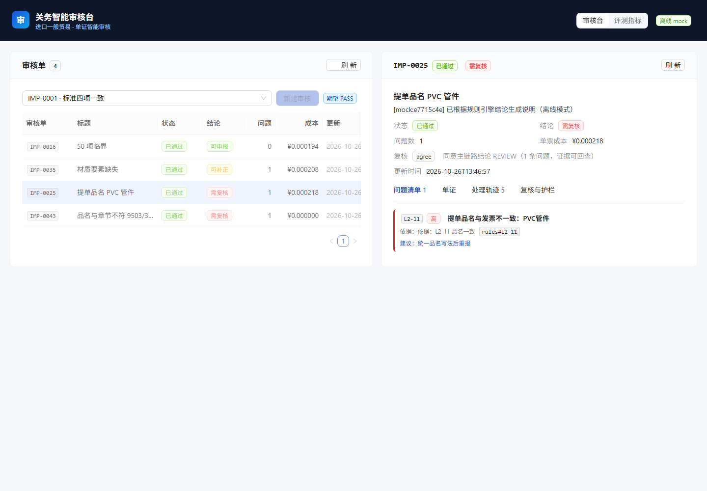
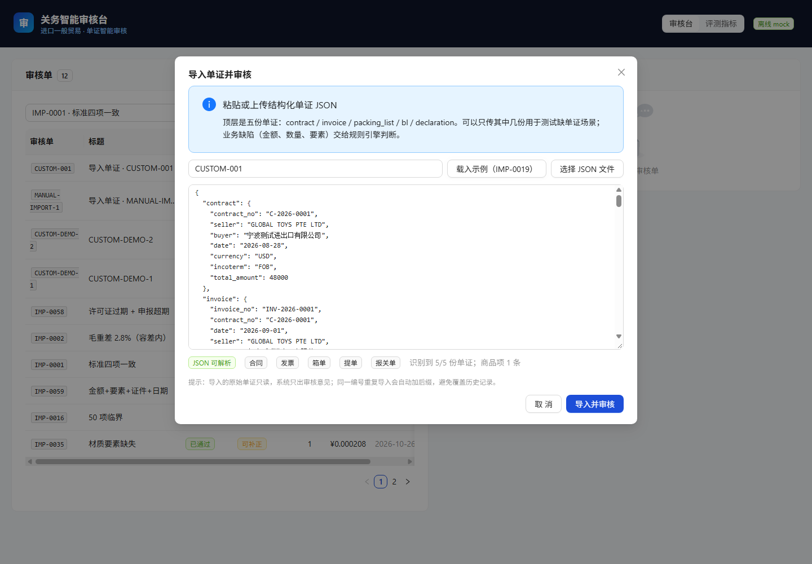
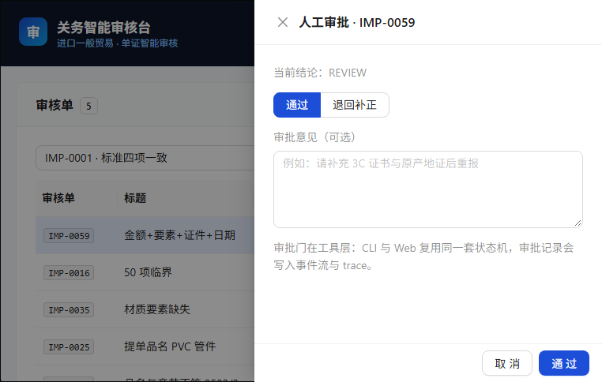

# 04 · 报关员使用手册（D10）

> 适用：**进口一般贸易**、单证已由识别环节转成结构化 JSON。
> 读者是报关员 / 复核主管 / 现场实施同学，不要求懂 AI 或编程。
> 本手册只讲“怎么用、怎么看、怎么反馈”；规则细节见 `01-rule-library.md`，架构见 `03-architecture.md`。

---

## 1. 它帮你做什么

一句话：**在正式申报前，把“这张单能不能报、缺什么、该找谁补”先过一遍。**

它做四件事：

1. 查**四单一致**：合同、发票、装箱单、提单、报关单草单之间的品名、数量、金额、币制、重量、件数是否对得上；
2. 查**申报要素**：按 10 位商品编号核对品牌、材质、用途、工艺、成分等要素是否齐全；
3. 给**归类建议**：只给 6 位编码建议和置信度，**不自动改判**，必须人工确认；
4. 提示**监管证件**：3C、许可证、原产地证、双反、食品注册号等是否缺失或过期。

它**不做**：不自动申报、不碰单一窗口/海关系统、不修改原始单证、不替人做归类判决。

---

## 2. 一分钟上手

### 2.1 Web 审核台（推荐）

打开浏览器访问审核台（默认 `http://127.0.0.1:8000`）：

1. 左侧是审核单列表；顶部选一票合成用例，点「新建审核」；
2. 点某一行，右侧出现单票详情；
3. 看「问题清单」：每条问题都带规则编号和依据；
4. 如果状态是「待审批」，点右上角「人工审批」，填写意见后通过或退回；
5. 顶部「评测指标」可以看当前评测的准确率、召回、误报、成本和延迟。



### 2.2 命令行（批量/排障用）

```bash
# 跑一票：自动通过审批（演示用）
python -m src.app.cli audit IMP-0025 --auto --offline

# 挂起在待审批，稍后续跑
python -m src.app.cli audit IMP-0025 --pause
python -m src.app.cli resume IMP-0025 --auto

# 列审核单 / 看某一票
python -m src.app.cli list
python -m src.app.cli show IMP-0025
```

> 离线模式（`--offline`）使用 mock 模型，结论可复现；接真实模型时去掉 `--offline` 并配置环境变量，见 README。

### 2.3 导入自己的单证

审核台顶部有「导入单证」按钮，支持两种方式：

**A. 结构化 JSON**（原有）

1. 粘贴 JSON，或点「选择 JSON 文件」上传 `.json`；
2. 可点「载入示例」先用 `IMP-0019` 的合成单证试；
3. 案件编号可留空（自动生成），也可手填；
4. 点「导入并审核」，进入单票详情。

**B. 原始单证（W7）**

1. 切到「原始单证（Excel / PDF / 扫描件）」页签；
2. 把 `.xlsx` / `.xlsm` / `.pdf` / 扫描件图片拖进上传区（最多 12 个，单个 20MB）；
3. 点「解析并审核」，系统自动识别单证类型、抽字段、建单并审核；
4. 详情页新增「原始单证」页签：看每个文件/页的识别结果、置信度、缺字段和转人工提示。

> 扫描件需要服务端装 `requirements-ocr.txt`（RapidOCR）；未安装时接口会明确提示
> 「未安装 OCR 引擎」，并返回 400，不会静默放行。`.xls` 旧格式请先另存为 `.xlsx`。



JSON 顶层是五份单证：

```json
{
  "contract": { ... },
  "invoice": { ... },
  "packing_list": { ... },
  "bl": { ... },
  "declaration": { ... }
}
```

- 至少需要 `invoice` 或 `declaration`；
- 只传部分单证也可以，系统会按“缺单证”转 `REVIEW`，适合测试；
- `invoice.items` / `declaration.items` 必须是非空数组；
- 单文件 ≤ 1MB；
- 示例文件：[`examples/docs.example.json`](../examples/docs.example.json)；
- 真实感测试数据（5 票，PASS/FIX/REVIEW/REJECT）：[`examples/realistic/`](../examples/realistic/)。

> 导入的单证会保存到 `var/docs/`，只读；同一编号重复导入会自动加后缀，避免覆盖历史。

---

## 3. 四类结论怎么读

| 结论 | 白话 | 你该做什么 |
|---|---|---|
| **PASS** | 没发现问题，可直接申报 | 报关员最后确认一遍即可 |
| **FIX** | 有明确、可改的问题（金额差、数量差、要素缺失等） | 按问题清单逐条补正/改单，改完重新审核 |
| **REVIEW** | 需要人判断（归类冲突、证件补办、口径不一致） | 转主管复核；确认后决定补正还是退回 |
| **REJECT** | 依规不得申报（禁限、缺前置资质） | 退回货主，说明不得申报的理由 |

**重要**：`REVIEW` 不是“系统不会判”，而是“系统不敢替你判”。归类、证件、口径冲突这类问题，必须由人拍板。

---

## 4. 一条问题怎么看证据

每条问题至少包含：

| 字段 | 含义 | 例子 |
|---|---|---|
| `rule_id` | 规则编号 | `L2-13` |
| `severity` | 严重度：high / mid / low | `high` |
| `field_path` | 出问题的字段位置 | `declaration.total_amount` |
| `message` | 人话描述 | 报关单总价与发票总额不一致 |
| `citation` | 规则/法规来源 | 内审 SOP |
| `citation_chunk` | 可回查的语料片段编号 | `rules#L2-13` |
| `evidence` | 两侧取值（能看到差在哪） | invoice=48000, declaration=47880 |
| `suggestion` | 补正建议 | 以发票为准核对总价 |

**怎么用**：先看 `evidence` 确认差在哪，再看 `citation` 确认依据，最后按 `suggestion` 处理。不要只看结论标签。

---

## 5. 审核到底查了什么（四层）

| 层 | 查什么 | 典型规则 |
|---|---|---|
| L1 完整性与格式 | 必填项、日期、币制、单位、金额勾稽、毛净重、件数 | L1-01 ~ L1-10 |
| L2 单证一致性 | 四单品名/数量/金额/币制/重量/件数/收货人/原产国/单号/唛头 | L2-11 ~ L2-22 |
| L3 申报要素与归类 | 要素齐全、枚举值、材质/用途/工艺、成分合计、品名-编码冲突、归类建议 | L3-23 ~ L3-32 |
| L4 监管与合规 | 3C/许可证/原产地证、协定税率、贸易方式、禁限、双反、食品、舱单、完税价格、申报期限、木质包装、许可证有效期 | L4-33 ~ L4-44 |

规则依据分两类：**公开依据**（填制规范、税则、监管条件表）和**企业内审 SOP 假设**（容差阈值等）。评测报告会标注，别把假设当法规。

---

## 6. 补正与复核怎么处理

### 6.1 FIX（能直接改的）

- 金额/数量/重量/件数不一致：以发票或箱单为准，核对后改单；
- 要素缺失：按 10 位编码的规范申报要素补齐；
- 合同号/提单号/唛头不一致：统一单证写法；
- 运保费漏报/重复报：按成交方式（FOB/CIF/CFR）重算完税价格构成。

### 6.2 REVIEW（要人判断的）

- **归类冲突**：系统只给 6 位建议，必须由归类员/报关员确认；必要时申请预裁定；
- **监管证件**：3C、许可证等缺失通常可补办，补办期间不要申报；
- **原产地/协定税率**：确认原产地证是否有效、是否符合直运规则；
- **口径冲突**：不同规则对同一字段有不同口径时，按更严重的结论处理并留痕。

### 6.3 REJECT（不能报的）

- 旧机电、固体废物、濒危物种等禁限类目；
- 缺食品境外生产企业注册号等前置资质；
- 这类单不要尝试“改到能报”，直接退回货主。

---

## 7. 审批流程

```
DRAFT → REVIEWING → PENDING_APPROVAL → APPROVED
                              └──────→ RETURNED → REVIEWING（补正后重审）
```

- 哪些要审批：`REVIEW` / `REJECT` 必审；`FIX` 且含高危问题也要审；`PASS` 自动通过。
- 审批人必须写意见；**退回时意见必填**（写清楚缺什么、找谁补）。
- 审批记录会进入事件流和 trace，可追溯“谁在什么时候改了什么”。
- Web 与 CLI 复用同一套审批门，不存在两套逻辑。



---

## 8. 常见问题

**Q1：为什么归类只给 6 位，不直接改 10 位？**
A：归类是法律责任，系统只做“相似品名 + 置信度”的建议；6 位是国际通用层级，10 位涉及本国子目和监管条件，必须人工确认。

**Q2：金额差多少算不一致？**
A：总额容差 **0.1%**（总额是精确值）；行级“单价×数量”勾稽容差 1%（单价四舍五入会漂）。这是内审假设，不是海关法规。

**Q3：发票日期晚于提单日，为什么有时只告警？**
A：预开票/补开票场景合法，所以只保留“提单日 ≤ 申报日”为硬约束；发票日期仅告警。

**Q4：系统会不会自己申报？**
A：不会。它只输出审核意见和补正建议，不接单一窗口/海关系统。

**Q5：为什么有些单证缺失会直接 REVIEW？**
A：单证不齐无法完成四单比对，系统不猜；先补齐再审核。

**Q6：数据安全吗？**
A：演示数据全部合成；生产接入时需要按企业数据分级、脱敏、访问控制来落地。原始单证只读，系统不修改。

**Q7：结论和我想的不一样怎么办？**
A：按第 9 节反馈闭环提交；保留 `case_id`、规则编号、你的判断和依据，便于复盘。

---

## 9. 反馈闭环（D10）

### 9.1 反馈入口

在审核台每条结论旁提供「反馈」按钮（或在工单里附以下模板）：

```
case_id：
rule_id / 字段：
系统结论：
我的判断：
依据（法规/税则/内审 SOP）：
是否紧急：
```

### 9.2 分类与时限

| 类型 | 例子 | 处理 |
|---|---|---|
| 规则误报 | 正常单被报 FIX | 24h 内确认，修规则/加用例 |
| 规则漏报 | 明显问题没报 | 24h 内确认，补规则/数据 |
| 阈值争议 | 重量 3% 太松/太紧 | 周会讨论，改假设并回归 |
| 归类争议 | 建议编码不对 | 转归类员，沉淀到相似库 |
| 体验问题 | 字段看不懂/审批太慢 | 产品迭代 |

### 9.3 每周复盘（30 分钟）

1. 本周反馈按类型计数；
2. 新增/修改的规则是否让评测退化（跑 `make eval`）；
3. 误报 Top3、漏报 Top3 各定一个动作；
4. 更新规则库版本与手册。

### 9.4 指标

- 采纳率：审批通过 / 总审核单；
- 修正率：人工改判 / 系统结论；
- 平均处理时长；
- 反馈关闭率；
- 评测回归：准确率、召回、误报、引用覆盖。

> 当前项目没有真实客户与驻场数据，以上是**影子运营**的反馈设计，不谎称“已上线”。

---

## 10. 数据与合规

- 演示数据全部合成，不含真实企业名、单号、个人信息；
- 规则依据来自公开填制规范/税则/监管条件表；企业内审阈值标注为假设；
- 原始单证只读，Agent 只出补正建议；
- 归类只给建议，不自动改判；
- 生产落地时需补充：数据分级、脱敏、审计日志、权限与留存策略。

---

## 11. 术语（白话）

| 词 | 白话 |
|---|---|
| 报关单 | 向海关申报货物信息的法定单据，字段固定、有填制规范 |
| 随附单证 | 合同、商业发票、装箱单、提单，报关时一起交 |
| HS 编码 | 国际通用商品编码，前 6 位全球统一，中国用 10 位 |
| 申报要素 | 海关要求申报的具体属性：品牌、材质、用途、规格、成分等 |
| 完税价格 | 海关计税的基础金额，通常 = 成交价 + 运保费 + 佣金等 |
| 监管证件 | 3C、许可证、原产地证等，缺了不能放行 |
| 舱单 | 运输工具上载货的清单，报关数据要与之匹配 |
| 滞报金 | 进境 14 日内未申报，按日征收的罚款 |
| FDE | 驻场交付工程师，要下客户现场 |
## 追问（v1.6）

审核单详情页每条问题右下角有「为什么？」按钮，也可以直接调接口：

```bash
python -m src.app.cli ask CUS-20261026-163340 "为什么报关单总价和发票差 25 美元？"

curl -s -X POST http://127.0.0.1:8000/api/cases/CUS-20261026-163340/ask \
  -H "Content-Type: application/json" \
  -d '{"question":"L2-18 该怎么改？"}'
```

回答必须带 `evidence` 与 `citations`；如果问题跟本票单证无关，会返回
`confidence=low, uncited=true` 并说明「无法从单证确认」，**不会硬答**。
离线（mock）下走关键词路由；接真模型后同样受「只允许引用已取证据」的约束。

## 从文本抽取（v1.6，POC）

```bash
curl -s -X POST http://127.0.0.1:8000/api/extract \
  -H "Content-Type: application/json" \
  -d '{"text":"发票号：INV-2026-0901\n币制：USD\n商品：塑料制玩具配件 800 个 单价 12.5 金额 10000.00"}'
```

返回 `docs`（可直接导入审核）、`confidence`（逐字段）、`needs_human`（低置信字段与缺失单证）。
**这条接口只处理文本**；Excel / 文字层 PDF / 扫描件请走原始文件上传：

```bash
curl -s -X POST http://127.0.0.1:8000/api/ingest \
  -F "files=@examples/raw/合成发票-INV-2026-0901.xlsx" \
  -F "files=@examples/raw/pdf/报关单-DEC-2026-0901.pdf" \
  -F "case_id=UPLOAD-001"
```

返回审核单详情 + `ingest`（识别到的单证、逐文件置信度/缺字段/转人工）；`GET /api/cases/{id}/ingest` 可回查。
扫描件需要服务端安装 `requirements-ocr.txt`（RapidOCR），未装会明确报错，不静默放行。
## 当前用的是什么模型（v1.6）

不用猜，直接看接口或页面：

```bash
curl -s http://127.0.0.1:8000/api/health
```

```json
{"status":"ok","scenarios":60,"rules":46,
 "model":{"offline":true,"active":"mock","llm":"mock",
          "routes":{"summarize":"cheap","classify":"cheap","extract":"cheap",
                    "review":"strong","ask":"strong"},
          "tiers":{"cheap":"gpt-4o-mini","strong":"gpt-4o"}}}
```

- `offline=true` → 全部走 MockLLM（可复现、零成本）；页面右上角显示绿色「离线 mock」；
- `offline=false` → 页面显示蓝色「在线模型 · cheap=gpt-4o-mini / strong=gpt-4o」，
  鼠标悬停可看路由表。

切换方式（改完**必须重启**才生效）：

```powershell
$env:LOGIAGENT_LLM_API_KEY  = "sk-xxx"
$env:LOGIAGENT_MODEL_CHEAP  = "gpt-4o-mini"
$env:LOGIAGENT_MODEL_STRONG = "gpt-4o"
$env:LOGIAGENT_LLM_BASE_URL = "https://..."   # 走网关时填
```

> 提醒：接真模型后单票成本会从「字符数÷2 的估算」变成「API 真实 usage × 单价」，
> 记得同时用 `LOGIAGENT_PRICE_INPUT_PER_1K` / `LOGIAGENT_PRICE_OUTPUT_PER_1K` 校准单价。
